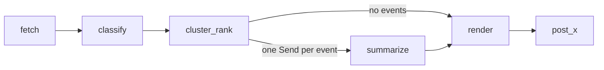

# lg-workflows

My personal collection of [LangGraph](https://github.com/langchain-ai/langgraph) workflows, shared publicly
in case any of it is useful to others. It is built around my own setup (a local model server, an LLM gateway,
a few CLI coding agents, and a Linux desktop running systemd), so expect to adapt the configuration rather
than run it as-is.

## Workflows

| Workflow | Entry point | Schedule | What it does |
|---|---|---|---|
| Hourly news digest | `lg_workflows.news.hourly` (graph `news_hourly`) | Every hour | Collects US politics, China politics, and AI news, merges reports of the same event, ranks events, writes a Chinese Markdown digest with summaries and Hacker News comment sentiment, and optionally posts the hottest events to X. |
| Daily news digest | `lg_workflows.news.daily` | 23:50 daily | Condenses the day's hourly events into one digest with key takeaways. |

More workflows will be added over time. They share the components described under
[Shared components](#shared-components).

## Shared components

Model access, agents, and alerts live outside any single workflow, so every graph can reuse them.

| Module | Provides |
|---|---|
| `lg_workflows/models.py` | `local_llm()` for a local OpenAI-compatible server (bulk work, no usage limits) and `brain_llm()` for a gateway model (planning and synthesis, rate-limited). |
| `lg_workflows/cli_agents.py` | Runs CLI agents (`claude -p`, `agy`, Cursor `agent`) headlessly with read-only or edit permissions, session resume, and output parsing. |
| `lg_workflows/agent_bridge.py` | LangGraph adapters for the CLI agents: `cli_agent_node(...)` to use one as a node, and `ask_claude_code` / `ask_gemini_agent` / `ask_cursor_agent` to use them as tools, with session ids kept in graph state. |
| `lg_workflows/notify.py` | Alerts through desktop notifications and/or a Telegram bot. `alert(key, ...)` announces a problem once (and again daily while it lasts); `resolve(key, ...)` announces the recovery once. |
| `lg_workflows/x_browser.py` | Posts to X through a logged-in Chrome profile, with X's weighted character counting. |
| `lg_workflows/smoke.py` | Checks that every configured model backend answers. |

## Setup

### 1. Prerequisites

- **[uv](https://docs.astral.sh/uv/)**, which also installs the right Python (3.12, pinned in `.python-version`):
  ```bash
  curl -LsSf https://astral.sh/uv/install.sh | sh
  ```
- **Two OpenAI-compatible endpoints** (pointing both at the same one works too):
  - A local or self-hosted server (llama.cpp, vLLM, Ollama, LiteLLM, ...) for bulk work. The news workflow
    sends it a few hundred requests per day.
  - A gateway or provider for the "brain" model. The news workflow uses it only for the daily digest.
- **Optional:**
  - CLI agents, for workflows that use them (the news workflows do not): [Claude Code](https://docs.anthropic.com/en/docs/claude-code)
    (`claude`), Antigravity (`agy`), [Cursor CLI](https://cursor.com/cli) (`agent`). Install and log in to each
    one following its own instructions.
  - Google Chrome, for posting to X.
  - A Telegram bot, for alerts on your phone.

### 2. Clone and install

```bash
git clone https://github.com/DiamondGo/LangGraph-Workflows.git ~/source/langgraph-workspace
cd ~/source/langgraph-workspace
uv sync
```

`uv sync` creates `.venv/` and installs the runtime and dev dependencies (LangGraph CLI, pytest) from
`uv.lock`. The clone location only matters for the systemd units, which assume this path.

### 3. Configure `.env`

```bash
cp .env.example .env
```

Then edit `.env`. It is gitignored: keep real endpoints, keys, and tokens only there.

| Variable | Meaning |
|---|---|
| `LOCAL_BASE_URL`, `LOCAL_API_KEY`, `LOCAL_MODEL` | Local server for bulk work. Must support tool calling (used for structured output). A reasoning model works best; `local_llm(thinking=False)` sends `reasoning_effort="none"` for fast labeling. |
| `GATEWAY_BASE_URL`, `GATEWAY_API_KEY`, `BRAIN_MODEL` | Brain model. `gpt-*` models are called through the Responses API. |
| `CLAUDE_MODEL`, `AGY_MODEL`, `CURSOR_MODEL` | Model names for the CLI agents. No keys: the CLIs use their own logins. |
| `NOTIFY_CHANNELS` | Where alerts go: `desktop`, `telegram`, or both (comma-separated). Default `desktop`. |
| `TELEGRAM_BOT_TOKEN`, `TELEGRAM_CHAT_ID` | Telegram bot for alerts. See [Alerts](#alerts). |
| `X_POST_MODE` | `off` (default), `dry_run`, or `live`. See [Posting to X](#posting-to-x). |
| `X_CHROME_PROFILE` | Optional. Chrome profile used for X; default `data/x_chrome_profile`. |
| `LANGSMITH_*` | Optional. Enables tracing in LangSmith. |

### 4. Check the setup

```bash
uv run pytest -q                       # unit tests, no network needed
uv run python -m lg_workflows.smoke    # OK/FAIL per model backend
uv run python -m lg_workflows.notify test
```

The smoke test checks `local`, `brain`, `claude`, `agy`, and `cursor`. A `FAIL` for a CLI agent you did not
install is expected and harmless.

### 5. First run

```bash
uv run python -m lg_workflows.news.hourly
```

The first run downloads the embedding model (`BAAI/bge-small-en-v1.5`, about 65 MB) into `data/models/`
and creates the SQLite databases in `data/`. It takes 10–30 minutes, depending on your local model's speed.
Later runs only process new items and usually take 3–8 minutes.

Then [install the schedulers](#scheduling).

## News digest

### How it works



| Step | Runs on | What it does |
|---|---|---|
| `fetch` | Code | Reads RSS feeds, Google News searches (last 2 hours), and the Hacker News front page and top stories. Drops Chinese state media and anything already reported. |
| `classify` | Local model, no thinking | Labels each headline as US politics, China politics, AI, or other, in batches of 40. Labels are cached. |
| `cluster_rank` | Local embeddings | Merges reports of the same event (average-linkage clustering) and ranks events per topic. |
| `summarize` | Local model, thinking | One parallel branch per event: reads up to 3 articles and the HN comments, writes a Chinese title, summary, and comment summary. Retries without thinking if the server is slow. |
| `render` | Code | Writes `data/digests/YYYY-MM-DD/HH00.md` and marks the event's items as reported. |
| `post_x` | Chrome | Posts the hottest events to X, if enabled. |

Each event is scored as heat × 0.5^(age / 6 h), where heat adds 1.0 per major outlet and 0.3 per other
outlet reporting it, plus 0.5·ln(1 + HN points) and 0.5·ln(1 + HN comments). Each topic shows up to 10
events scoring at least 0.5; when fewer qualify, it is topped up to 3 with the best remaining ones.

Runs are checkpointed in SQLite (`data/news_checkpoints.db`) per hour: an interrupted run resumes where it
stopped, and a finished hour is never run twice. Fetch failures and summary failures are listed at the end
of the digest.

The daily digest (`news.daily`) sends the day's stored events to the brain model once and writes
`data/digests/YYYY-MM-DD/daily.md`.

Topics, feeds, outlet weights, thresholds, and posting limits are all in `lg_workflows/news/config.py`. To
add a topic, add a `Topic` there and its key to the `CLASSIFY` prompt in `lg_workflows/news/prompts.py`.

Digests are written in Chinese. Prompts and publishers are keyed by language, so an English edition can be
added without changing the graph; `--lang en` currently raises `NotImplementedError`.

### Running by hand

```bash
uv run python -m lg_workflows.news.hourly            # this hour's digest (skips if already done)
uv run python -m lg_workflows.news.hourly --force    # rerun this hour
uv run python -m lg_workflows.news.daily             # today's daily digest
uv run python -m lg_workflows.news.daily --date 2026-10-30
```

### Posting to X

The hourly digest can post its hottest events to X: up to 3 per run, each scoring at least 1.5, skipping
stories posted in the last 24 hours, and never from the 03:00, 04:00, or 05:00 runs. Each post is the Chinese
title, as many whole summary sentences as fit in 280 weighted characters, and a link to the article.

It drives a logged-in Chrome profile instead of the paid API. **This automates the X website, which X's
automation rules forbid, and can get the account restricted. Use it at your own risk.** It never bypasses
verification: a login prompt or challenge stops posting and sends an alert.

```bash
uv run python -m lg_workflows.x_browser login   # log in to X in the window that opens, then close it
uv run python -m lg_workflows.x_browser check   # confirms the session works headlessly
```

Then set `X_POST_MODE` in `.env`:

- `dry_run` fills the compose box and saves a screenshot to `data/x_screenshots/`, but never posts.
- `live` posts.

The setting is read on every run, so changing it takes effect at the next hour. Posted texts and links are
recorded in the `x_posts` table of `data/news.db`.

## Alerts

Workflows report problems through `lg_workflows.notify`. Today that covers X posting: an expired login,
a verification challenge, a rejected or unconfirmed post (immediately), and other errors (after two in a row).
An ongoing problem is announced once and then daily; its recovery is announced once. Alert state is kept in
`data/alerts.json`.

Desktop alerts use `notify-send` and stay on screen until dismissed. To add Telegram:

1. Message [@BotFather](https://t.me/BotFather), send `/newbot`, and put the token in `TELEGRAM_BOT_TOKEN`.
2. Send any message to your new bot, then print your chat id and put it in `TELEGRAM_CHAT_ID`:
   ```bash
   uv run python -m lg_workflows.notify chat-id
   ```
3. Set `NOTIFY_CHANNELS=desktop,telegram` and send a test:
   ```bash
   uv run python -m lg_workflows.notify test
   ```

## Scheduling

`deploy/systemd/` contains systemd user units:

| Unit | When |
|---|---|
| `news-hourly.timer` | On the hour, with up to 60 s random delay. A run missed while the machine was off runs once at startup. |
| `news-daily.timer` | 23:50. No catch-up, because the job builds the current date; rebuild a missed day with `--date`. |

They assume the repo is at `~/source/langgraph-workspace`; edit `WorkingDirectory` in the `.service` files if
yours is elsewhere.

```bash
cd deploy/systemd
systemctl --user link "$PWD/news-hourly.service" "$PWD/news-daily.service"
systemctl --user enable --now "$PWD/news-hourly.timer" "$PWD/news-daily.timer"
loginctl enable-linger "$USER"   # keep timers running while logged out
```

Useful commands:

```bash
systemctl --user list-timers 'news-*'      # next and last runs
journalctl --user -u news-hourly -f        # follow the hourly log
systemctl --user disable --now news-hourly.timer news-daily.timer   # stop
```

## Development

- **Tests:** `uv run pytest -q`. They mock models, browsers, and notifications, so no network is needed.
- **Studio:** graphs are registered in `langgraph.json`; `uv run langgraph dev` serves them to
  [LangGraph Studio](https://smith.langchain.com/studio/?baseUrl=http://127.0.0.1:2024). Running a graph there
  is a real run: it fetches, writes a digest, and marks items as reported.
- **Local state:** everything generated lives in `data/` (gitignored): databases, digests, the embedding
  model cache, the X Chrome profile, screenshots, and alert state.

### Layout

```
src/lg_workflows/
  models.py, cli_agents.py, agent_bridge.py   # model and agent access
  notify.py, x_browser.py, smoke.py           # alerts, X posting, backend check
  news/                                       # news digest workflows
    hourly.py, daily.py                       #   graph and daily job
    config.py, prompts.py                     #   topics, feeds, tunables, prompts
    sources.py, clustering.py, store.py       #   fetching, event grouping, SQLite
    publish.py, x_post.py                     #   Markdown output, X posting
deploy/systemd/                               # schedulers
tests/
```
